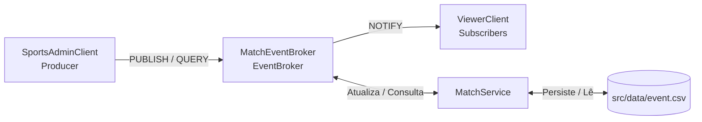

# Relatório Técnico – Trabalho 4

## Comunicação Indireta em Sistemas Distribuídos: Modelo Publicar e Assinar

---

## 1. Introdução

Este trabalho foi desenvolvido com foco na comunicação indireta em sistemas distribuídos, seguindo a abordagem **Publicar e Assinar (Publish/Subscribe)**. A arquitetura adotada diferencia-se da comunicação direta por chamada de procedimento remoto (RPC), pois produtores e consumidores não estabelecem conexões diretas nem conhecem a identidade ou localização uns dos outros. Em vez disso, ambos interagem por meio de um intermediário central (**Broker**) que recebe as publicações em tópicos e dissemina notificações aos assinantes interessados.

O cenário de aplicação escolhido foi o monitoramento e transmissão de partidas de futebol em tempo real. A solução modela um ambiente distribuído onde ações como criação de partidas, gols, cartões e encerramentos de jogos são publicadas por um painel administrativo em um canal específico e entregues instantaneamente a múltiplos clientes espectadores inscritos, além de serem persistidas em disco para tolerância a falhas e entrega retroativa.

---

## 2. Objetivo do Trabalho

O objetivo principal foi projetar e implementar um sistema distribuído em Python para eventos esportivos seguindo o paradigma **Publicar e Assinar**. A solução demonstra como uma entidade produtora envia eventos para um canal compartilhado enquanto diversas entidades consumidoras recebem atualizações de estado conforme o tópico assinado.

Os requisitos contemplados pela solução incluem:
- cadastro de múltiplas partidas simultâneas;
- publicação de eventos esportivos (`CREATE_MATCH`, `GOL`, `CARD`, `END`) em tópicos;
- inscrição dinâmica de múltiplos clientes espectadores via sockets TCP;
- disseminação assíncrona de notificações em tempo real e entrega retroativa de eventos acumulados (desacoplamento temporal);
- manutenção *thread-safe* do placar e do histórico de eventos em memória;
- persistência automática dos eventos em arquivo CSV com recuperação após reinicialização;
- consultas síncronas ao placar, histórico de lances e lista de jogos ativos.

---

## 3. Fundamentação Teórica

A comunicação indireta é um paradigma em que os componentes distribuídos se comunicam por meio de um mediador (como um broker de eventos ou serviço de mensageria). A principal vantagem dessa abordagem é o **desacoplamento** entre produtores e consumidores em três dimensões:

- **Desacoplamento espacial:** produtores publicam mensagens em tópicos sem conhecer o endereço IP, a porta ou a quantidade de consumidores conectados;
- **Desacoplamento temporal:** produtores e consumidores possuem tempos de vida independentes; mensagens publicadas enquanto um assinante está desconectado são retidas pelo Broker e entregues assim que ele se inscreve no tópico;
- **Desacoplamento de sincronização:** o fluxo de publicação não bloqueia o processamento dos consumidores, permitindo entrega *push* baseada em eventos.

Na arquitetura publicar e assinar, o produtor classifica a informação associando-a a um tópico (`match.events`), enquanto os consumidores expressam interesse assinando esse canal junto ao Broker.

---

## 4. Arquitetura da Solução

A arquitetura implementada divide-se nas camadas de cliente, servidor (Broker e serviços de domínio) e infraestrutura compartilhada.

### 4.1 Componentes Principais

- **`SportsAdminClient` (`src/client/admin_client.py`):** cliente produtor com interface interativa em linha de comando (CLI) que permite cadastrar partidas, publicar eventos e consultar placares;
- **`ViewerClient` (`src/client/viewer_client.py`):** cliente consumidor que assina tópicos e exibe as notificações recebidas em formato textual limpo no terminal;
- **`MatchEventBroker` (`src/server/main_server.py`):** servidor TCP multithread que coordena o recebimento de conexões, interpreta comandos do protocolo, aciona o serviço de partidas e dispara notificações;
- **`EventBroker` (`src/server/services/event_broker.py`):** implementa o mecanismo base de gerenciamento de assinaturas por tópico, histórico em memória, entrega retroativa e envio via socket com tratamento automático de desconexões;
- **`MatchService` (`src/server/services/match_service.py`):** camada de negócio *thread-safe* responsável por validar entradas, atualizar placares e gerenciar a persistência em CSV;
- **`EventProtocol` (`src/shared/infra/protocol.py`):** padroniza a serialização e desserialização das mensagens JSON delimitadas por quebra de linha (`\n`);
- **`Match`, `MatchEvent`, `GoalEvent` e `CardEvent` (`src/shared/models/`):** classes que representam o domínio esportivo;
- **`MatchEventInputStream` e `MatchEventOutputStream` (`src/shared/streams/`):** fluxos de entrada e saída responsáveis pela leitura e gravação persistente dos eventos em arquivo CSV.

### 4.2 Fluxo de Comunicação



---

## 5. Modelo de Domínio e Persistência

O domínio esportivo foi estruturado utilizando orientação a objetos, herança e o padrão de projeto *Factory*:

### 5.1 Partida (`Match`)
A classe `Match` armazena o identificador único da partida (`match_id`), os nomes das equipes mandante (`home_team`) e visitante (`away_team`), e os respectivos placares (`home_score` e `away_score`), além de fornecer serialização para formato CSV.

### 5.2 Eventos da Partida (`MatchEvent`, `GoalEvent`, `CardEvent`)
A classe base `MatchEvent` encapsula `event_id`, `match_id`, `event_type`, `description` e `timestamp`. A partir dela, especializam-se:
- **`GoalEvent`:** adiciona o atributo `team` (equipe autora do gol);
- **`CardEvent`:** adiciona o atributo `player` (jogador advertido).

### 5.3 Persistência em CSV
Sempre que um evento é registrado no `MatchService`, ele é gravado no arquivo `src/data/event.csv` por meio da classe `MatchEventOutputStream`. Caso o servidor seja reiniciado, o `MatchService` utiliza `MatchEventInputStream` no construtor para recarregar o histórico e reconstruir o estado das partidas em memória, sincronizando-o também com o histórico do Broker.

---

## 6. Protocolo e Comunicação

A troca de mensagens ocorre sobre sockets TCP utilizando objetos JSON delimitados por `\n` (para evitar coalescência de pacotes no buffer de rede). As operações suportadas pelo `EventProtocol` são:

- **`SUBSCRIBE`:** inscreve o cliente em um tópico específico e dispara a entrega retroativa de eventos acumulados;
- **`PUBLISH`:** envia uma ação de criação de partida ou lance esportivo ao Broker;
- **`NOTIFY`:** mensagem enviada pelo Broker aos assinantes do tópico com os dados do evento e o placar atualizado;
- **`QUERY`:** solicita de forma síncrona o placar (`score`), o histórico (`events`) ou a lista de partidas (`matches`);
- **`ACK`:** resposta de confirmação (`SUBSCRIBED`, `PUBLISHED`, `OK`) ou erro (`ERROR`) enviada pelo Broker.

### Exemplo de Mensagem de Publicação (`PUBLISH`)

```json
{
  "action": "PUBLISH",
  "topic": "match.events",
  "payload": {
    "event_type": "GOL",
    "match_id": 1,
    "team": "Flamengo",
    "player": "Pedro",
    "description": "Pedro marcou aos 15'"
  }
}
```

### Exemplo de Notificação aos Assinantes (`NOTIFY`)

```json
{
  "action": "NOTIFY",
  "topic": "match.events",
  "payload": {
    "event_type": "GOL",
    "match_id": 1,
    "team": "Flamengo",
    "player": "Pedro",
    "description": "Pedro marcou aos 15'",
    "home_team": "Flamengo",
    "away_team": "Vasco",
    "home_score": 1,
    "away_score": 0
  }
}
```

---

## 7. Controle de Concorrência e Serviços

### 7.1 Thread-Safety
Como o `MatchEventBroker` cria uma *thread* dedicada para cada cliente conectado via TCP, acessos simultâneos ao estado compartilhado são protegidos por travas reentrantes (`threading.RLock` no `MatchService` e `threading.Lock` no `MatchEventBroker`). Isso evita condições de corrida (*race conditions*) durante a atualização de placares, geração de IDs sequenciais e escrita no arquivo CSV.

### 7.2 Enriquecimento de Mensagens
Antes de acionar o `EventBroker.publish()`, o `MatchEventBroker` enriquece o *payload* do evento com os nomes das equipes e o placar atualizado (`home_score` e `away_score`), permitindo que os clientes espectadores exibam o estado completo do jogo sem precisar realizar consultas adicionais.

---

## 8. Fluxo de Operação

1. O servidor `MatchEventBroker` é iniciado e escuta conexões TCP na porta configurada (`5000`), carregando eventos prévios do `event.csv` para a memória e para o histórico do tópico.
2. O administrador utiliza o menu interativo do `SportsAdminClient` para enviar um `PUBLISH` de cadastro de partida (`CREATE_MATCH`) e registrar lances (`GOL`, `CARD` ou `END`).
3. A cada lance publicado, o `MatchService` valida os dados, atualiza o placar em memória e persiste o registro no `event.csv`.
4. O Broker armazena a mensagem no histórico do tópico e dissemina a notificação (`NOTIFY`) para todos os sockets inscritos no momento.
5. Caso um `ViewerClient` conecte-se posteriormente, o Broker envia a confirmação (`ACK`) seguida automaticamente de todos os eventos acumulados no histórico do tópico.

---

## 9. Validação e Testes

A validação do sistema foi conduzida por meio de testes funcionais em ambiente Linux (Ubuntu), utilizando múltiplos terminais simultâneos para simular a rede distribuída (conforme roteiro em `docs/MANUAL_TEST.md`):

Use o código com cuidado.
* Teste de desacoplamento espacial e entrega em tempo real: verificação de que o SportsAdminClient envia eventos apenas ao Broker (sem conhecer IPs/portas dos espectadores) e que múltiplos ViewerClient recebem notificações instantaneamente;
* Teste de desacoplamento temporal (assinante offline): publicação de partidas e gols sem nenhum ViewerClient em execução, comprovando que ao iniciar o espectador posteriormente ele recebe automaticamente os eventos ocorridos enquanto estava desconectado;
* Teste de integridade de domínio e consultas: validação de regras de negócio (bloqueio de partidas duplicadas, validação de times participantes) e das consultas síncronas de placar, eventos e jogos ativos;
* Teste de persistência: encerramento abrupto do servidor Broker seguido de reinicialização, comprovando a leitura do arquivo src/data/event.csv e a restauração do histórico.

---

## 10. Justificativa da Escolha Arquitetural

Para o cenário de monitoramento e transmissão de lances esportivos em tempo real, a arquitetura Publicar-Assinar (Opção B) mostrou-se mais adequada do que as demais alternativas de comunicação indireta:
* Em relação a Filas de Mensagens (Opção C): filas ponto a ponto entregam cada mensagem a apenas um consumidor (modelo competing consumers). Em uma transmissão esportiva, um mesmo gol precisa ser recebido simultaneamente por todos os espectadores inscritos, comportamento nativo do Pub/Sub.
* Em relação à Comunicação em Grupo / Multicast (Opção A): o multicast exige gerenciamento complexo de membros e não oferece nativamente retenção de histórico para clientes que entram após o início da partida (desacoplamento temporal).
* Em relação ao Espaço de Tuplas (Opção D): a leitura associativa em memória compartilhada exigiria que os espectadores realizassem consultas contínuas (polling) ou buscas por padrões, enquanto o Pub/Sub orienta a comunicação por eventos push em tópicos.

---

## 11. Análise de Desempenho (Overhead) e Estratégias de Mitigação

A introdução de um Broker intermediário elimina o acoplamento direto, mas impõe uma sobrecarga (overhead) de desempenho e complexidade operacional em comparação à comunicação ponto a ponto:
1. **Salto adicional de rede (Extra Hop) e Serialização:** Toda mensagem passa a realizar dois saltos TCP (Produtor → Broker → Consumidores) e sofre múltiplos processos de marshalling/unmarshalling em JSON.
2. **Contenção por Concorrência e I/O em Disco:** O uso de travas (threading.RLock) para garantir consistência no placar e a escrita síncrona em event.csv a cada evento aumentam a latência de resposta do PUBLISH.
3. **Ponto Único de Falha (SPOF) e Crescimento de Histórico:** Centralizar o roteamento no Broker concentra o tráfego de rede e o consumo de memória RAM devido à retenção de mensagens para entrega retroativa.

### 11.1 Estratégias de Mitigação

* **Particionamento por Tópicos Granulares:** Em vez de concentrar todos os jogos em um único canal (match.events), utilizar tópicos específicos por partida (ex: match.1, match.2) reduz o tráfego desnecessário enviado aos clientes.
* **Persistência Assíncrona ou em Lote (Batching):** Desacoplar a escrita no arquivo CSV utilizando uma thread dedicada ou flush periódico reduz o bloqueio de I/O durante picos de eventos.
* **Limitação do Histórico em Memória (Janela Deslizante / TTL):** Definir um limite máximo de eventos retidos por tópico evita o esgotamento de memória RAM em transmissões de longa duração.
* **Serialização Binária:** Em cenários de alta escala, substituir JSON textual por formatos binários compactos (como Protocol Buffers ou MessagePack) reduz o tamanho dos pacotes TCP e o tempo de CPU no parsing.